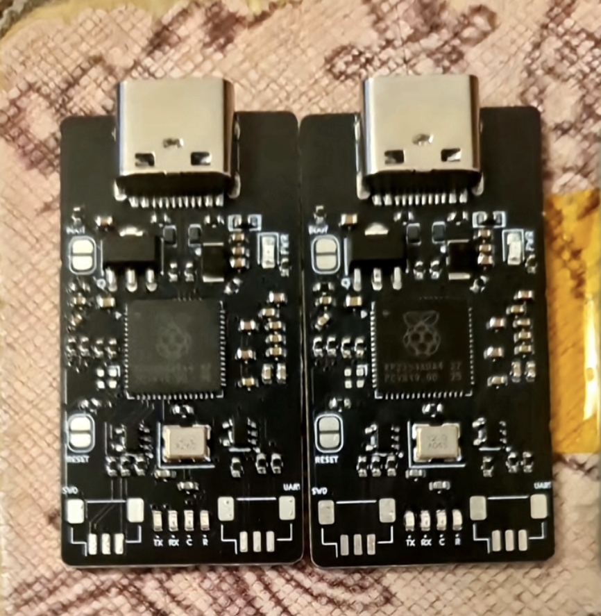
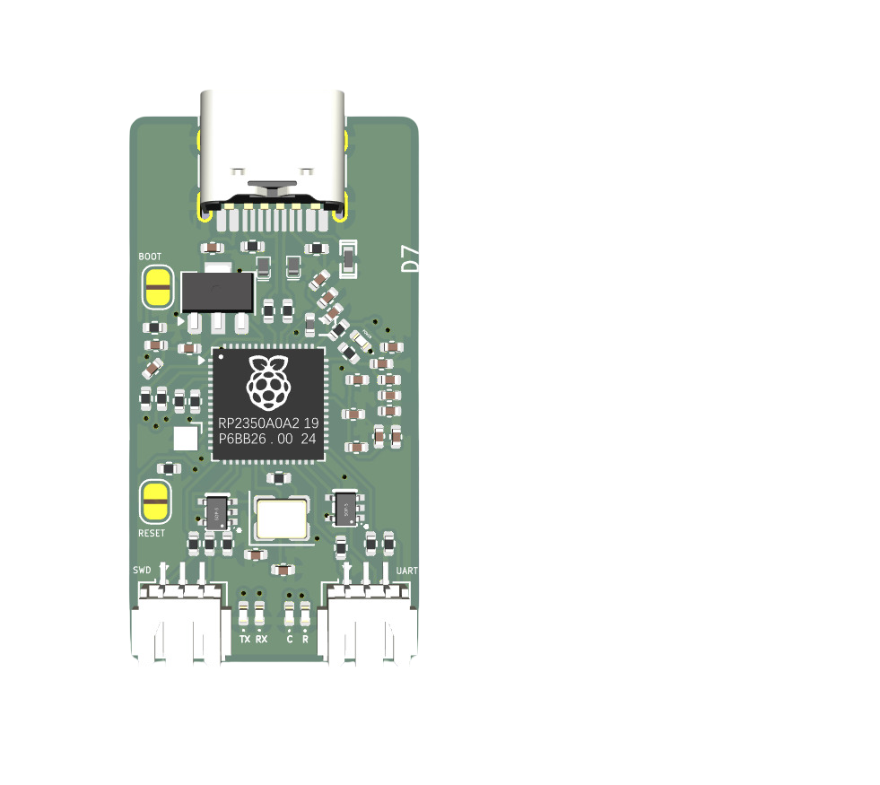
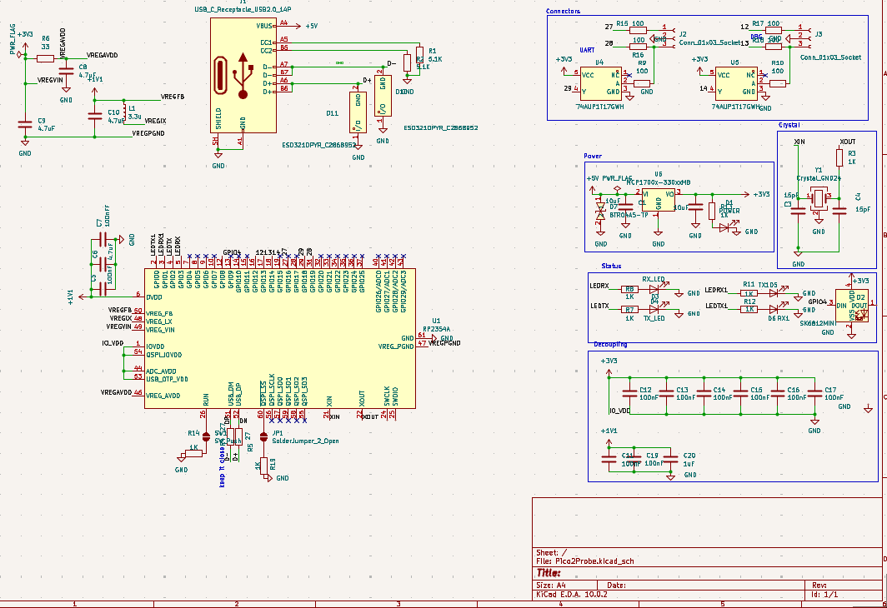
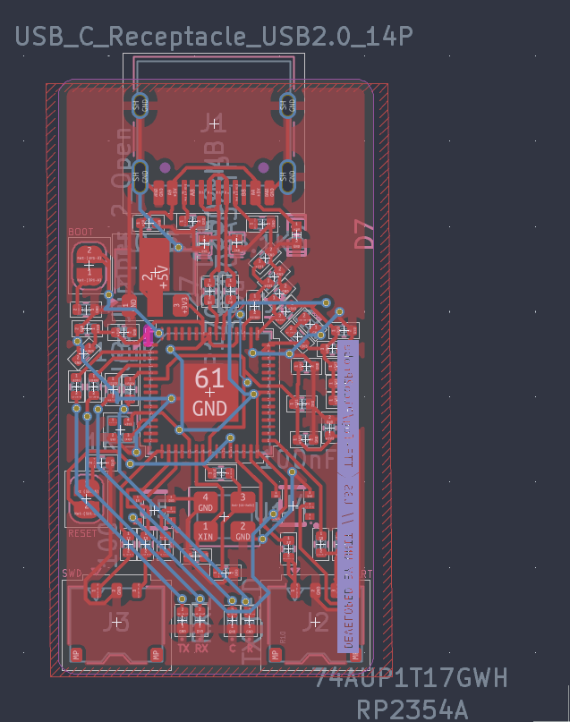
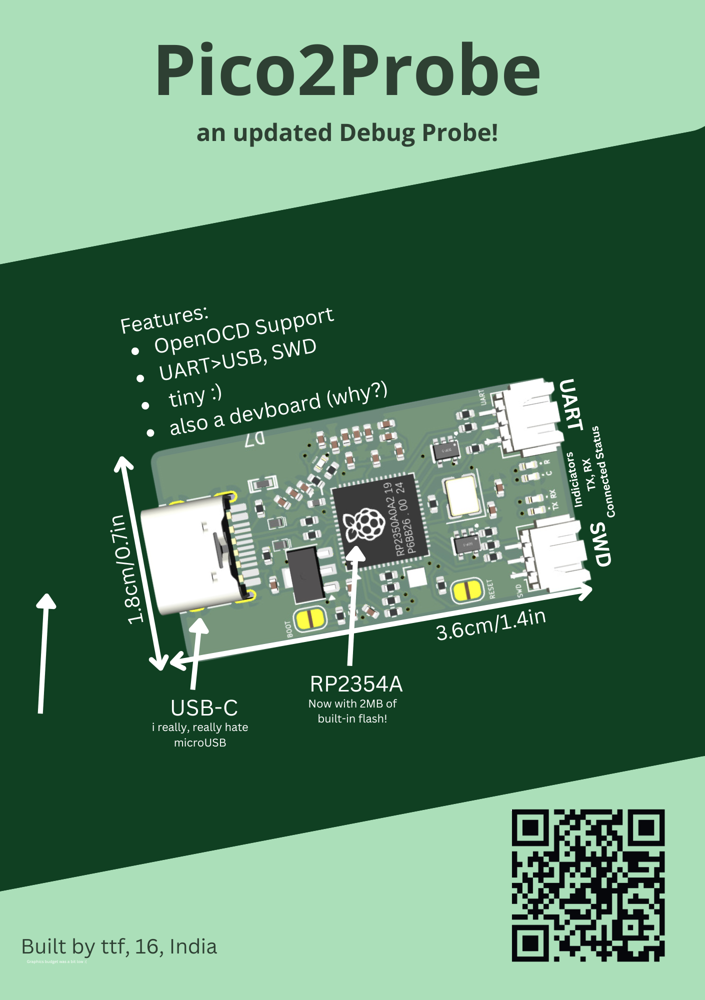

# a RP2354-based debugprobe

An updated version of the original [debugprobe](https://www.raspberrypi.com/documentation/microcontrollers/debug-probe.html) with the following changes - 
- Based on the RP2354A
- USB-C (i just really hate micro-b)
- a configurable addressable RGB led

### Build


SWD, uart works

# Why did i make this?

1. Does one need to justify the act of creation? (or, in other words, why not?) (please do not take that out of context)
2. I had no way of debugging except plain UART (which is annoying), so i wanted something that would let me use an actual debugger
3. Wanted to make something using the RP2354A

# Setting Up
1. the board will already have a bootloader on it, plug it in and mount the drive
2. do git submodule sync and git submodule update --init --recursive
3. cd into debugprobe directory and
4. cmake -B build-pico2probe -DPICO_BOARD=pico2probe && make -C build-pico2probe -j$(nproc)
5. drag the pico2probe.uf2 file into the flash drive

# Firmware Modifications
- opening and closing the port at 1200 baud automatically puts the device into BOOTSEL mode
- board support files for the pico2probe
# Usage
for UART RX/TX, 
```shell
screen /dev/ttyACMx
```
for using SWD, eg. flashing a rp2040 do:
```shell
sudo openocd -f interface/cmsis-dap.cfg -f target/rp2040.cfg -c "adapter speed 5000" -c "program blink.elf verify reset exit"
```
# (Sub)Links
- [BOM](PCB/production_files/BOM.csv)
- [Design Files](PCB/Design%20Files/)
- [Schematic PDF](PCB/Design%20Files/schem.pdf/Pico2Probe.pdf)
- [Zine](zine.pdf)
- [Gerbers](PCB/production_files/GERBER-Pico2Probe.zip)

# Images





# Current Issues
- Silkscreen text is difficult to read due to small size
- buffer on UART is on wrong pin
- uses green and red leds, not yellow and red leds
- solder jumpers are difficult to use reliably
- bootsel does not work due to resistor configuuration issues
